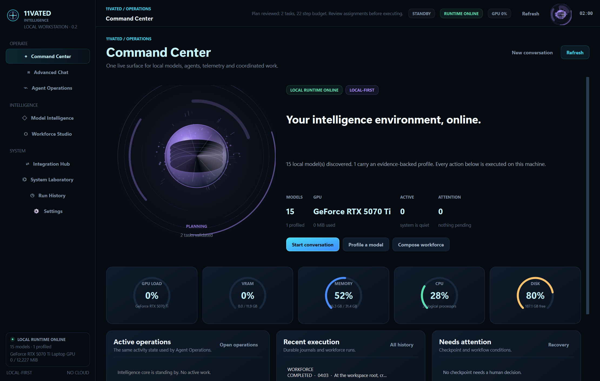

# 11vated Intelligence — Ollama Agent Workstation

**Any model. Any agent. Any workflow.**

A local-first, Windows-first desktop agent workstation from 11vatedTech. Its defining subsystem is the **Universal Agentification Engine**: inventory a model, research its origin, test its real capabilities, assign an evidence-backed professional identity, then equip it with a bounded execution harness.

> **Release status: v0.2 development increment on the 0.1.0 foundation — locally verified, not production-certified.** The branch adds a structured publisher dossier, persistent metadata profiles for every installed artifact, repeatable local profiling, a provider-enforced independent verifier contract, runtime-owned execution leases with heartbeat and lease-loss fail-closed behavior, a versioned benchmark suite that feeds profiles and routing, hardware/inference telemetry, model-digest enforcement, scoped project memory, expanded identity/workforce roles, host-side tool-schema validation, an encrypted durable recovery boundary, a host-controlled multi-agent workforce, hardware-aware model routing and a redesigned nine-workspace desktop/CLI workflow. The broader production gates are tracked in [Production Readiness](docs/PRODUCTION_READINESS.md).

## Product thesis

Ollama supplies local inference. This workstation provides the operational system around a model:

1. **Discover** installed models and inspect `/api/show` metadata.
2. **Research** upstream model cards; candidate matches are suggestions and require explicit user confirmation.
3. **Profile** low-cost tasks for instruction following, structured output, structured actions, native tools, code generation/comprehension, reasoning and arithmetic.
4. **Identify** a model-specific professional title, primary role and secondary strengths from observed results. Unknowns remain unknown.
5. **Agentify** using native tool calling where it works, otherwise structured actions or a guided text-action protocol.
6. **Execute** bounded tasks in a selected workspace with host-enforced tool validation and permissions.
7. **Verify and retain** run traces and model profiles in local SQLite.

## Architecture

`Desktop / CLI → Application services → Ollama provider + Model Intelligence Engine → Universal Agentification Engine → Agent runtime → Policy-enforced tools → Verification and evidence → SQLite`

The core is provider/harness/UI separated. The desktop shell does not duplicate inference or tool policy. Read [Architecture](docs/ARCHITECTURE.md), [Model Intelligence](docs/MODEL_INTELLIGENCE.md), [Desktop Intelligence Interface](docs/UI_INTERFACE.md), [Production Readiness](docs/PRODUCTION_READINESS.md), the dated [Research Register](docs/RESEARCH_REGISTER.md) and the [Changelog](CHANGELOG.md).

## Desktop intelligence interface

The PySide6 shell is organized as nine workspaces: **Command Center**, **Advanced Chat**, **Model Intelligence**, **Workforce Studio**, **Agent Operations**, **Integration Hub**, **System Laboratory**, **Run History & Recovery** and **Settings**. It uses shared design tokens and components, a custom `QPainter` intelligence core, real inventory/profile/telemetry data, streamed chat with cooperative stop, local conversation persistence, workforce approvals and the existing durable recovery controls. Reduced-motion mode and compact layouts are available from the same shell; the current gallery covers 1480 × 940, 1120 × 720, 1280 × 800, 1024 × 768 and 900 × 700.



The interface is documented with its validation matrix, screenshot gallery and known limitations in [Desktop Intelligence Interface](docs/UI_INTERFACE.md). It is a locally verified engineering surface whose verifier-hardening head had a green hosted matrix; the execution-integrity branch needs a fresh run. It is not a production-certified UI: screen-reader/high-contrast validation, clean-VM validation and exhaustive intermediate scaling remain open.

## Implemented in the current development branch (pre-release v0.2)

| Capability | Status |
|---|---|
| Ollama health, model inventory, model metadata and loaded-model inspection | Implemented |
| Local model smoke probes and inventory-wide metadata profiles | Implemented; `profile-all` covers every installed artifact; empirical smoke probes and benchmark evidence remain per-model and explicitly unassessed when not run |
| Evidence-backed professional title and expanded role taxonomy | Implemented; provisional pending role qualification |
| Model intelligence metadata and evidence-aware routing | Implemented; declared-only routing is marked provisional and unverified |
| Opt-in Hugging Face model-card research | Implemented in CLI and desktop; explicit repository selection required; lexical match is only a hint |
| Structured publisher dossier | Implemented for model description, intended use, limitations, training/evaluation disclosures, datasets, base model, languages, license and provenance hash |
| Repeatable smoke profiling | Implemented with 1–5 trials, pass-rate aggregation and confidence tracking; not a full benchmark suite |
| Host and inference telemetry | Implemented with system RAM/CPU snapshots, best-effort NVIDIA telemetry, Ollama token counters, load timing and derived generation throughput |
| Agent Identity Package export | Implemented |
| Native tool-call loop | Implemented |
| Structured/guided tool catalogue and action contracts | Implemented; host validation required before execution |
| Streaming cancellation and command cleanup | Desktop closes active Ollama streams; commands use best-effort process-group/taskkill cleanup, not OS isolation |
| Agent execution budgets | Max 8 tool calls per step, 64 per run, reject batches over 32, serialized-context accounting, and 256 KB bounded stdout/stderr capture |
| Durable run journal and Run History UI | Ordered SQLite events are written during execution; desktop history shows completed and crash-interrupted runs |
| Structured JSON action fallback and guided text action fallback | Implemented |
| Workspace-scoped file tools | Implemented with containment, size limits, host schemas, credential-path denial and heuristic secret-value redaction before model context |
| Optional allow-listed command tool | Implemented but disabled by default; configured executable resolution and human approval required; not a sandbox |
| SQLite profile, conversation, run, checkpoint and scoped-memory persistence | Implemented; explicit scoped notes, lexical recall/archive, per-event durable run journal and Run History UI. Embeddings remain open |
| Durable run recovery | Implemented: integrity-hashed safe-boundary checkpoints, exact model-digest/workspace/harness/tool-manifest binding, AES-256-GCM checkpoint payloads with a separate local key, desktop and CLI recovery, fail-closed review for interrupted tools, and runtime-owned atomic execution leases with heartbeat, active-lease recovery blocking and lease-loss shutdown |
| PySide6 desktop shell and headless CLI | Implemented with the nine-workspace intelligence interface, shared design system, live inventory/profile/telemetry, streamed chat and stop, local conversations, workforce approvals, diagnostics, history/recovery and settings; Windows UI tests and import are configured in CI; full interactive QA on supported hardware remains |
| Workforce orchestration | Implemented: evidence-backed role selection, validated DAG plans, sequential delegation, shared workspace, budgets, timeouts/cancellation, retry-safe failure handling, approvals, independent verdict/artifact checks, durable hash-chained events and desktop/CLI controls. Qualification remains explicit |
| MCP client transport certification | Implemented for the official SDK v2 over stdio and Streamable HTTP: real subprocess/uvicorn integration tests cover discovery, invocation, timeout, cancellation, crash detection, reconnection, schema-drift refusal, process/session cleanup and concurrent clients |
| Full MCP server, ACP, browser/computer-use adapters, parallel/distributed scheduling, specialist benchmark adapters, OS sandbox and role/agent certification | Roadmap |

## Requirements

- Python 3.11+ (3.12 recommended)
- Ollama installed and running
- Optional: the official MCP Python SDK v2 via the `mcp` extra
- One or more models pulled with Ollama
- Windows 11 is the primary desktop target; core services are cross-platform

## Install on Windows

```powershell
py -3.12 -m venv .venv
.\.venv\Scripts\Activate.ps1
python -m pip install --upgrade pip
python -m pip install -e ".[desktop,dev]"
```

Check Ollama:

```powershell
ollama --version
ollama list
Invoke-RestMethod http://127.0.0.1:11434/api/version
```

Launch:

```powershell
python -m ollama_workstation
```

## CLI

```powershell
11vated models
11vated profile-all
11vated profile-all --probes
11vated profile qwen2.5-coder:7b --metadata-only
11vated profile qwen2.5-coder:7b --repeats 3
11vated benchmark qwen2.5-coder:7b --suite core --repeats 3
11vated run qwen2.5-coder:7b .\agent-workspace "Inspect this project and summarize its architecture"
11vated workforce run "Inspect this project and document its architecture" .\agent-workspace --mode analysis --model qwen2.5-coder:7b --yes
11vated workforce status
11vated route --capability tool_calling --context 16384
11vated doctor
11vated research qwen2.5-coder:7b
11vated attach-model-card qwen2.5-coder:7b Qwen/Qwen2.5-Coder-7B-Instruct
11vated export-agent qwen2.5-coder:7b
```

The profile probe suite makes several model calls and loads the selected model. `--repeats 1..5` repeats each smoke probe and records pass rate, confidence and inference metrics. The separate `benchmark` command runs the versioned six-case `11vated-core` suite with independent exact, numeric, JSON-schema and ordered-term evaluators. It writes a JSON report containing the model digest, manifest SHA-256, per-case trial outcomes, Wilson intervals, latency/throughput and host snapshot. This local core suite is a deterministic diagnostic—not a leaderboard, statistical certification or substitute for SWE-bench, BFCL, OSWorld or specialist audits. Read the [Research Register](docs/RESEARCH_REGISTER.md) before interpreting public benchmark scores.

## Durable run recovery

Agent execution persists an integrity-checked checkpoint at three safe boundaries: immediately before each provider request (`awaiting_model`), before a tool batch (`tool_in_progress`) and after a completed tool batch (`ready`). Each checkpoint is bound to the exact Ollama model digest, canonical workspace, task, harness mode and host tool-manifest hash. An envelope SHA-256 covers every binding column, counter, timestamp and the bounded, redacted conversation payload, so altering a stored workspace, digest or freshness timestamp invalidates recovery instead of silently resuming different execution.

Recovery is fail-closed:

- `ready` and `awaiting_model` checkpoints are resumable only when the stored profile digest is available, the installed Ollama digest still matches and the rebuilt tool manifest is identical.
- A run interrupted during a tool operation becomes `needs_review`. It is never replayed automatically, because the host cannot prove whether the side effect occurred.
- Corrupt payloads, tampered bindings, unsupported protocols, completed runs and checkpoints older than the 72-hour recovery window are refused.
- Only completed runs (and deterministic step/context exhaustion) delete their checkpoint. Cancelled and failed runs retain one for explicit review.

CLI:

```powershell
11vated recover --list
11vated recover RUN_ID
11vated recover RUN_ID --discard
```

The desktop **Run History** page lists the same candidates, explains why each is or is not resumable, requires confirmation before resuming and verifies the live model digest again. Resume reuses the original run ID, appends a `resumed` event to the durable journal and continues within the original step budget rather than granting a fresh one. Every repository-backed agent run now owns an atomic execution lease from the runtime, with a background heartbeat. A live lease marks the checkpoint `LEASED / ACTIVE` and blocks CLI or desktop resume; an expired lease is reclaimable. If ownership is lost during execution, the runtime stops before the next provider request, checkpoint or tool operation rather than risking concurrent workspace writes.

Checkpoint payloads are encrypted at rest with AES-256-GCM using a 32-byte key stored separately from SQLite (`.checkpoint.key` by default, or the path in `OLLAMA_WORKSTATION_CHECKPOINT_KEY_FILE`). The legacy plaintext format remains readable for migration. The checkpoint envelope hash still binds digest, workspace, harness, tool manifest, counters and timestamps.

## Model intelligence, routing and workforce

`ModelProfiler` feeds a structured model-intelligence record parsed from Ollama `/api/show`: family/architecture, parameter count, quantization, context capacity, declared tools/vision/embedding capabilities, KV/memory estimates and evidence levels. Estimates are marked inferred, not measured.

`ModelRouter` ranks installed artifacts by required capability, context, memory envelope, observed quality, speed preference and explicit fallback chain. Observed capability scores take precedence; declared-only metadata is permitted only for provisional routing and is labelled `unverified`.

The **Workforce** page and `11vated workforce` command execute a host-validated DAG. Children run sequentially against the assigned workspace with tool policy and step/time budgets. Plans and consequential task boundaries require approval. A task completes only when the child runtime reports `completed` and host artifact checks pass. An independent read-only verifier receives the acceptance criteria and an immutable manifest, must return the typed `11vated-verifier/1` JSON verdict, and the host rechecks paths, sizes and SHA-256 values before writing the audit. Prose is normalized through one provider-enforced schema pass; a malformed result, missing evidence, changed artifact or substantive `FAIL` remains fail-closed. A model claim that a nonzero manifest artifact is missing or empty is recorded as a contradiction and cannot override passed deterministic acceptance checks. Every task and child event is stored in a SHA-256 hash-chained workforce journal. See [Workforce orchestration](docs/WORKFORCE.md).

`11vated doctor` and the rotating JSONL log under the application data directory provide structured operational evidence without uploading telemetry. See [Operations and performance](docs/OPERATIONS.md).

Current local evidence on this host: Ollama 0.40.16, 15 installed models, 15 metadata profiles, one empirical profile (`qwen2.5-coder:7b`), and a `66.67/100` core benchmark (8/12 trials). A live CLI analysis workflow (`23dc040f-1aa3-40d1-882a-b3a2c7f6b6e0`) and a desktop `WorkforcePage` workflow (`beee5cd1-342a-449b-994b-e47d3a53d9be`) both completed with `verification_passed=true`; a separate desktop run (`fb65bbb1-064e-4be6-9937-a40c2d3acd30`) correctly failed because the model claimed a write it never performed.

## Privacy and security

- Inference targets the configured Ollama endpoint.
- Remote model research is opt-in and disabled by default.
- Hardware telemetry is local-only (system memory/CPU and best-effort NVIDIA nvidia-smi); no telemetry is uploaded to a service.
- Models are untrusted input generators; the host validates tool calls.
- File tools are workspace scoped and size limited.
- Overwrites require approval.
- Shell execution is disabled by default; when enabled it is allow-listed, approval-gated, uses no `shell=True`, and is time limited.
- Credential-like values are heuristically redacted from workspace file/search output, command output, explicit memory, persisted run/workforce task descriptions, event payloads, structured logs and final agent responses. This is not a substitute for an OS secret broker or a complete secret scanner. No unrestricted browser, desktop-control, network or arbitrary Python-evaluation tool is exposed in this development increment. Command execution stays disabled in the desktop agent.

Read [SECURITY.md](SECURITY.md) before enabling command execution or using sensitive workspaces. The desktop stop button closes the active streamed Ollama request and is checked between tool operations. Command termination is best-effort; this does not replace OS-level run isolation. Workforce children share their assigned workspace, so the host's read-only tool wrapper is a policy boundary, not an OS sandbox.

## Optional MCP tool servers

The workstation includes an optional, deny-by-default MCP **client** integration. It uses the official Python SDK v2 and currently supports stdio child processes and Streamable HTTP endpoints. Install the extra only when MCP is required:

```powershell
python -m pip install -e ".[desktop,mcp]"
```

Configure servers under **Settings → MCP servers (JSON)**. Example:

```json
[
  {
    "name": "project_files",
    "transport": "stdio",
    "enabled": false,
    "command": "npx",
    "args": [
      "-y",
      "@modelcontextprotocol/server-filesystem",
      "C:/Users/YourUser/Projects"
    ],
    "approved_tools": [
      "list_allowed_directories",
      "list_directory",
      "read_file"
    ],
    "env_refs": {},
    "call_timeout_seconds": 45
  }
]
```

Every server is disabled by default. Set `enabled` only after reviewing the exact executable/package, source, permissions and transport. The host exposes only tool names explicitly listed in `approved_tools`; wildcard grants are rejected. JSON arguments are validated against the server's advertised schema, calls are bounded/cancellable, and MCP output is passed through credential redaction before it reaches the model. The model cannot grant itself additional tools.

For stdio servers, `env_refs` maps a child-process environment name to a variable already present in the workstation process, for example `{"SERVICE_TOKEN":"11VATED_MCP_SERVICE_TOKEN"}`. Only the variable names are written to settings; never paste a secret value into the JSON editor. The SDK uses a restricted child-process environment and configured references are passed explicitly.

For Streamable HTTP, use HTTPS for remote servers. Plain HTTP is accepted only for loopback/private IP endpoints. The versioned transport contract is in `agents/mcp_contract.py`; lifecycle diagnostics are available from `MCPToolGateway.diagnostics()`. A transport failure or timeout is an **unknown-outcome** error and is never retried automatically. Reconnection creates a new SDK session only for subsequent calls and refuses to expose a changed approved-tool manifest. The real transport certification suite runs with the MCP extra:

```powershell
python -m pip install -e ".[desktop,dev,mcp]"
pytest tests/test_mcp_integration.py -q
```

**OAuth, custom authorization headers, protected-resource discovery, MCP resources/prompts subscriptions, and an MCP server implementation are not part of this increment.** Do not configure a protected remote endpoint or treat TLS alone as authorization. A stdio MCP server is a local child process: this integration uses a transparent stdio supervisor in ordinary Python runs: it owns a second kill-on-close Job Object on Windows and a dedicated process group on POSIX. A frozen PyInstaller build cannot launch that module and falls back to the SDK cleanup; bundling a dedicated supervisor executable remains a packaging task. This does not sandbox the server process. Use only trusted servers and keep high-risk tools disabled.

The CLI uses the same saved `mcp_servers` configuration as the desktop. With all entries disabled or an empty list, ordinary local-agent execution does not require the MCP extra.

## Development

```powershell
python -m pip install -e ".[desktop,dev,mcp]"
pytest
ruff check .
python -m compileall -q src
```

CI is configured for Python 3.11/3.12 on Windows and Ubuntu and installs the `mcp` extra so the real transport suite runs in every matrix leg. The latest local Windows Python 3.12.13 run reports **191 passed, 4 skipped**, with Ruff and `compileall` clean. The earlier hosted run [43056402479](https://github.com/11vatedTech/Ollama-DesktopAgent/actions/runs/43056402479) passed all four jobs at the verifier-hardening head: Ubuntu 3.11/3.12 reported 176 passed/4 skipped and Windows 3.11/3.12 reported 175 passed/5 skipped, with Windows desktop import and 10 UI tests. The execution-integrity branch needs its own matrix result after push. The opt-in live Ollama tests remain skipped unless `OLLAMA_LIVE=1`. The Windows packaging workflow builds a PyInstaller distribution; installer signing and release certification remain open gates.

## Research sources

The project evaluates and benchmarks against open-source architecture candidates, including [Goose](https://github.com/aaif-goose/goose), [Interpreter Workstation](https://github.com/openinterpreter/interpreter-workstation), [OpenHands SDK](https://github.com/OpenHands/software-agent-sdk), [Codex CLI](https://github.com/openai/codex), [Grok Build](https://github.com/xai-org/grok-build), [Cline](https://github.com/cline/cline), [mini-SWE-agent](https://github.com/SWE-agent/mini-swe-agent), [Inspect AI](https://github.com/UKGovernmentBEIS/inspect_ai), [LangGraph](https://github.com/langchain-ai/langgraph), [Letta](https://github.com/letta-ai/letta), [Mem0](https://github.com/mem0ai/mem0) and [Browser Use](https://github.com/browser-use/browser-use). These are research candidates, not bundled dependencies. See [the dated primary-source research register](docs/RESEARCH_REGISTER.md) for findings, risks and benchmarks.

## Licensing

This project is licensed under Apache-2.0. Third-party projects in the research register are not copied into this repository. Review each exact revision, license, notices, dependencies and provenance before reuse.
