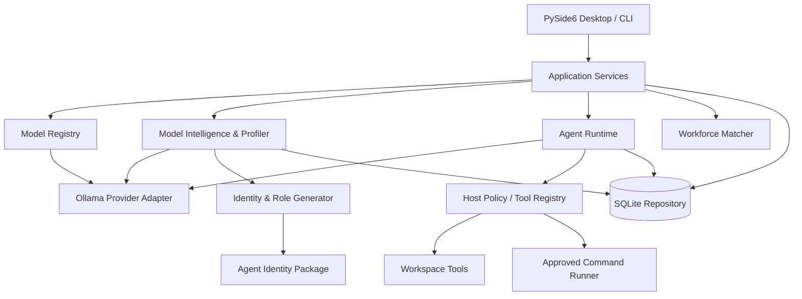
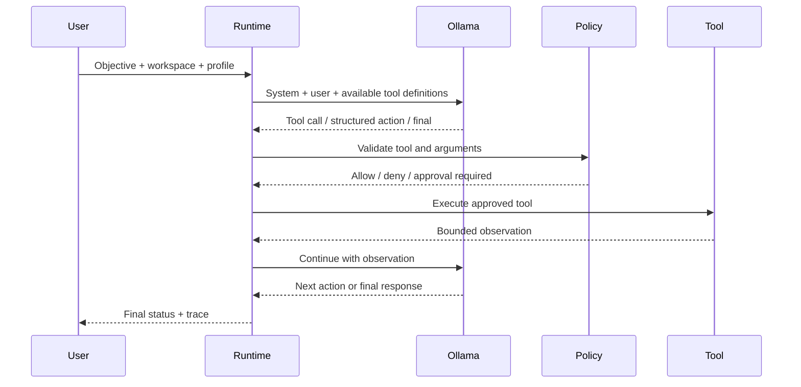

# Architecture and system boundaries

**Status:** Accepted initial architecture, 2026-11-10  
**Product:** 11vated Intelligence — Ollama Agent Workstation

## Design principles

1. Local-first inference; external research is an explicit opt-in.
2. Models are untrusted and capability is empirical, not inferred from branding.
3. Provider, agent harness, tool execution and desktop UX are separate layers.
4. Unknown capability is not zero and is never silently promoted to certified.
5. Host code enforces security boundaries; prompts only communicate them.
6. Every action has a trace and every completion claim needs evidence.
7. Prefer adapters and standards over hard-wiring a single agent framework.
8. Persisted profiles bind to Ollama model digests to detect model replacement.

## Logical architecture

## Component boundaries

### Desktop and application layer

`ui/` owns Qt presentation. It calls application services and must not contain capability heuristics or permission policy. Network and generation calls run in `QThreadPool` workers.

`cli.py` is a headless operational interface over the same client, profiler, repository and runtime services.

### Ollama adapter

`ollama/client.py` owns the HTTP contract and translates network, timeout, status and JSON failures into `OllamaError`. It uses native Ollama endpoints:

- `GET /api/version`
- `GET /api/tags`
- `POST /api/show`
- `GET /api/ps`
- `POST /api/chat`

Provider-specific response handling stays out of profile and agent logic. Streaming is not yet wired into Qt presentation.

### Model intelligence and identity

`profiling/profiler.py` gathers declared metadata and runs bounded, low-cost probes. Each result records method, status, score when meaningful, confidence, evidence and limitations.

`profiling/research.py` optionally searches public Hugging Face metadata. Search candidates are not treated as upstream identity automatically. A user must select the matching repository before claims are attached.

`models/identity.py` derives a title and role from observed capability results. One-shot probes are low confidence. Unknown and unassessed dimensions remain explicit.

### Agent runtime

`agents/runtime.py` owns the bounded control loop. It supports native tool calls and structured-action fallbacks. The model never directly calls Python functions: the host parses, validates tool names and arguments, applies policy and invokes registered tools.

`agents/tools.py` exposes workspace-scoped list/read/write/search tools and an optional allow-listed command tool. Shell execution is disabled by default and requires host approval.

### Persistence

`storage/repository.py` stores model profiles, agent run traces and conversation state in SQLite. Profiles are keyed by exact model name and Ollama digest.

## Agent execution sequence

## Core domain objects

- **ModelRef:** mutable Ollama inventory identity.
- **Evidence:** sourced claim with evidence level and retrieval time.
- **CapabilityResult:** result of a specific empirical test.
- **ModelProfile:** model digest, origin dossier, observed capabilities, role and operational data.
- **Agent Identity Package:** exported binding of profile evidence and a candidate runtime configuration.
- **AgentRun:** objective, status, event trace and timestamps.

## Architecture decisions

### ADR-001: Separate model from agent harness

A model is an inference backend. An agent is a policy-controlled execution loop around it. Agent identity packages bind both but do not alter model weights.

### ADR-002: Evidence levels are first-class

Publisher statements, runtime metadata, empirical observations and certification must not be conflated. A title can be proposed from sparse evidence, but must remain provisional until repeatable role-specific tests pass.

### ADR-003: No unrestricted shell by default

Native tool calls are validated by the host. The shell tool is opt-in, allow-listed and approval-gated. This is not equivalent to an OS sandbox; see SECURITY.md.

### ADR-004: Desktop and CLI share the same services

The GUI and CLI are clients of the same service layer. No model-specific logic or security policy is implemented in UI code.

## Deferred architecture

Streaming event bus, durable resumable runs, MCP/ACP adapters, browser and computer-use environments, sandboxed execution, project memory retrieval, dynamic multi-agent orchestration and hardware-aware model scheduling are explicitly later phases. They must use the same provider, policy, trace and evidence contracts.
