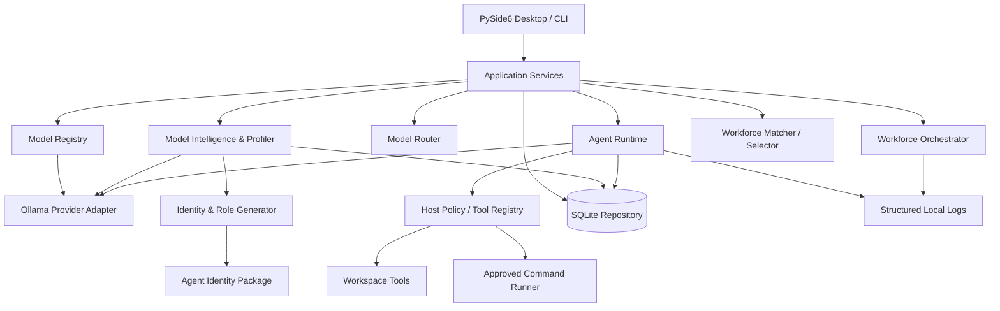
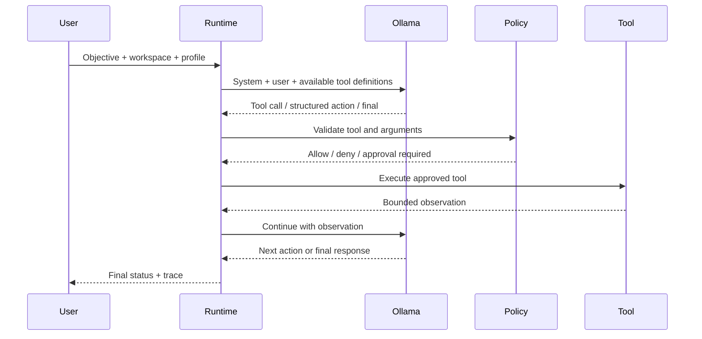

# Architecture and system boundaries

**Status:** Accepted initial architecture, 2026-11-10  
**Product:** 11vated Intelligence — Ollama Agent Workstation

## Design principles

1. Local-first inference; external research is an explicit opt-in.
2. Models are untrusted and capability is empirical, not inferred from branding.
3. Provider, agent harness, tool execution and desktop UX are separate layers.
4. Unknown capability is not zero and is never silently promoted to certified.
5. Host code enforces security boundaries; prompts only communicate them.
6. Every action has a trace and every completion claim needs evidence.
7. Prefer adapters and standards over hard-wiring a single agent framework.
8. Persisted profiles bind to Ollama model digests to detect model replacement.

## Logical architecture

## Component boundaries

### Desktop and application layer

`ui/` owns Qt presentation. It calls application services and must not contain capability heuristics or permission policy. Network and generation calls run in `QThreadPool` workers. `ui/state.py` carries the shared context, event bus and active-operation registry; `ui/telemetry.py` publishes host readings; `ui/intelligence_core.py` renders event-driven visual state; and `ui/pages/` contains the nine workspaces. The interface never invents activity or success: page state is updated only at provider, tool, recovery or workforce event boundaries. See [Desktop Intelligence Interface](UI_INTERFACE.md).

`cli.py` is a headless operational interface over the same client, profiler, repository and runtime services.

### Ollama adapter

`ollama/client.py` owns the HTTP contract and translates network, timeout, status and JSON failures into `OllamaError`. It uses native Ollama endpoints:

- `GET /api/version`
- `GET /api/tags`
- `POST /api/show`
- `GET /api/ps`
- `POST /api/chat`

Provider-specific response handling stays out of profile and agent logic. Streaming is not yet wired into Qt presentation.

### Model intelligence and identity

`profiling/profiler.py` gathers declared metadata and runs bounded, low-cost probes. Each result records method, status, score when meaningful, confidence, evidence and limitations.

`profiling/research.py` optionally searches public Hugging Face metadata. Search candidates are not treated as upstream identity automatically. A user must select the matching repository before claims are attached.

`models/identity.py` derives a title and role from observed capability results. One-shot probes are low confidence. Unknown and unassessed dimensions remain explicit.

`models/model_intelligence.py` turns Ollama metadata into an evidence-labelled record: architecture, family, parameter count, quantization, context, embedding/KV geometry, declared capabilities and inferred memory envelope. `models/routing.py` ranks installed artifacts by capability, context, memory, observed quality, speed and explicit fallback. A declared capability can make a route provisional; only observed capability satisfies a verified-only request. Memory estimates are inferred, never presented as measured.

### Workforce orchestration

`agents/orchestration.py` owns the host-validated plan/DAG, sequential child execution, budgets, cancellation, approval callbacks, artifact checks, verifier verdicts and durable workforce results. `agents/workforce.py` owns role matching and assignment selection. The orchestrator never trusts a model-generated plan: it validates task IDs, dependencies, cycles, step/time budgets and relative verification paths before executing anything. Each child uses the same workspace tool policy as a single agent; a read-only task receives a registry without write or command tools. Children receive prior results only as explicitly marked untrusted context.

A task is successful only if the child runtime returns `completed` and host artifact checks pass. A verifier task is independent and read-only; it receives acceptance criteria plus an immutable manifest and must return the typed `11vated-verifier/1` JSON verdict. The host schema-normalizes prose once, validates every cited path/digest and rechecks the artifacts before writing `workforce/verification.json` itself. Missing artifacts, changed artifacts, step-limit termination or blocked dependencies fail the workflow. A model `FAIL` that is directly contradicted by the immutable manifest is recorded but cannot override passed deterministic acceptance; substantive quality failures remain fail-closed. The host never overwrites an existing delivery artifact to manufacture verification evidence.

Workforce runs, task states, child events and results persist in SQLite. Events form a SHA-256 chain over sequence, kind, message, canonical data, time and previous hash. `WorkforceOrchestrator` records child progress and does not store raw unredacted event data; the CLI/desktop use the same service.

### Observability

`observability.py` writes rotating JSON Lines under the application data directory. CLI commands and desktop errors emit structured events with bounded, redacted metadata. `11vated doctor` reports provider health, model inventory, SQLite integrity, checkpoint-key presence, log presence and host telemetry. Logs are local-only; they are not uploaded.

### Agent runtime

`agents/runtime.py` owns the bounded control loop. It supports native tool calls and structured-action fallbacks. The model never directly calls Python functions: the host parses, validates tool names and arguments, applies policy and invokes registered tools. The runtime writes durable checkpoints at model-request and tool-batch boundaries; eligibility and binding verification are centralized in `agents/recovery.py` so the desktop, CLI and runtime enforce one recovery contract.

`agents/tools.py` exposes workspace-scoped list/read/write/search tools and an optional allow-listed command tool. Shell execution is disabled by default and requires host approval.

### MCP gateway

`agents/mcp_gateway.py` is a deny-by-default client adapter over the official MCP Python SDK v2. It owns configuration validation, exact per-server tool grants, host JSON-Schema validation, bounded/redacted results, lifecycle diagnostics and reconnect policy. The SDK owns JSON-RPC and the real transports: stdio subprocesses and Streamable HTTP sessions. Each connection runs on a dedicated event-loop thread; closing the gateway cancels the session and completes transport cleanup. In ordinary Python runs, a transparent supervisor process (`agents/mcp_stdio_wrapper.py`) owns a second kill-on-close Job Object on Windows and a dedicated process group on POSIX around the real server, covering the SDK's graceful-shutdown orphan gap. Frozen PyInstaller builds cannot start that module and use the SDK cleanup until a dedicated supervisor executable is bundled.

`agents/mcp_contract.py` version-stamps the transport contract. A transport failure or timeout is an unknown-outcome error and is never replayed. Replacing a session is allowed only for future calls; it re-discovers the tool list and refuses to expose changed schemas or descriptions. Real SDK server/reconnect/cancellation/cleanup evidence lives in `tests/test_mcp_integration.py`; mocked policy tests remain in `tests/test_mcp_gateway.py`.

### Persistence

`storage/repository.py` stores model profiles, agent runs, ordered run events, scoped memory, durable run checkpoints, workforce runs/tasks/events and execution leases in SQLite. Profiles are keyed by exact model name and Ollama digest. Checkpoints carry an envelope SHA-256 over the binding columns, counters, timestamps and bounded payload; a failed integrity check raises instead of returning partial state. Checkpoint payloads are encrypted at rest with AES-256-GCM using a separate 32-byte key file (legacy plaintext remains readable). Run leases are atomic SQLite claims with expiry; a live foreign lease is never stolen. The database itself and non-checkpoint journals are not whole-database encrypted.

## Agent execution sequence

## Core domain objects

- **ModelRef:** mutable Ollama inventory identity.
- **Evidence:** sourced claim with evidence level and retrieval time.
- **CapabilityResult:** result of a specific empirical test.
- **ModelProfile:** model digest, origin dossier, observed capabilities, role and operational data.
- **Agent Identity Package:** exported binding of profile evidence and a candidate runtime configuration.
- **AgentRun:** objective, status, event trace and timestamps.

## Architecture decisions

### ADR-001: Separate model from agent harness

A model is an inference backend. An agent is a policy-controlled execution loop around it. Agent identity packages bind both but do not alter model weights.

### ADR-002: Evidence levels are first-class

Publisher statements, runtime metadata, empirical observations and certification must not be conflated. A title can be proposed from sparse evidence, but must remain provisional until repeatable role-specific tests pass.

### ADR-003: No unrestricted shell by default

Native tool calls are validated by the host. The shell tool is opt-in, allow-listed and approval-gated. This is not equivalent to an OS sandbox; see SECURITY.md.

### ADR-004: Desktop and CLI share the same services

The GUI and CLI are clients of the same service layer. No model-specific logic or security policy is implemented in UI code. The desktop shell adds presentation state, worker orchestration and local view persistence, but it consumes the same profile, run, recovery and workforce services as the CLI.

### ADR-005: Recovery is a fail-closed boundary, not replay

A checkpoint may only be restored when protocol, integrity, binding, run status and freshness all verify. Tool side effects are not idempotent, so an interrupted tool batch is never replayed; it enters human review. Recovery reuses the original run ID and step budget and appends to the same event journal.

### ADR-006: MCP transport recovery is not tool replay

An MCP call that times out, crashes or loses its transport has an unknown side-effect outcome. The gateway marks that session failed and never resends the call. A later call may create a fresh SDK session; before exposing it, the host re-discovers tools and refuses the reconnect if the approved-tool manifest, schemas or descriptions changed. This keeps transport recovery from silently changing the policy surface.

### ADR-007: Workforce plans are untrusted host contracts

The host validates plans before creating a child. Model assignments, dependency edges, budgets, approval boundaries and verification targets are host-enforced data. A child is not a security boundary and never inherits permissions implicitly. Completion requires host artifact checks plus an independent verdict where configured.

### ADR-008: Recovery confidentiality and concurrency are separate controls

Checkpoint payload encryption protects conversation state at rest, while an integrity envelope binds recovery identity. A lease protects the right to resume/execute a run across processes. Neither substitutes for an OS sandbox or whole-database encryption; each is independently testable and fails closed.

## Deferred architecture

Streaming event bus, full ACP adapters, an MCP server, browser and computer-use environments, OS sandboxed execution, project memory retrieval, parallel/distributed workforce scheduling and whole-database encryption remain later phases. They must use the same provider, policy, trace and evidence contracts.
